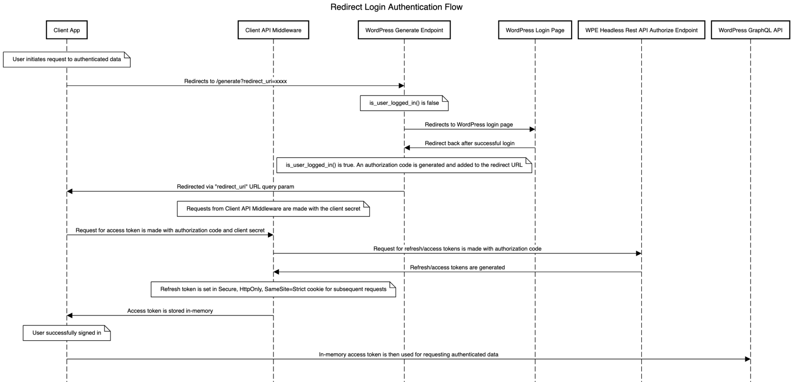

Understanding authentication is crucial for protecting your application's data. This page will guide you through implementing features from the Faust.js toolkit into your Next.js app.

Before starting, it helps to break down the process into three concepts:

1. **[Authentication](https://nextjs.org/docs/app/building-your-application/authentication#authentication)**: Verifies if the user is who they say they are. It requires the user to prove their identity with something they have, such as a username and password.

2. **[Session Management](https://nextjs.org/docs/app/building-your-application/authentication#session-management)**: Tracks the user's auth state across requests.

3. **[Authorization](https://nextjs.org/docs/app/building-your-application/authentication#authorization)**: Decides what routes and data the user can access.

This diagram shows the authentication flow using the Faust.js toolkit auth feature:



Redirect-based authentication is the default strategy in the Faust.js toolkit. This strategy involves redirecting the user to WordPress to authenticate. Once the user has shown authentication, the user redirects back to the Next.js application with an authorization code, which you can then use to request a refresh and access token, thus completing the login process.

This strategy is excellent for use cases where your authenticated users are admins/editors/etc. and do not necessarily need a “white label” login/register experience. Typically, you would use the redirect strategy if your primary reason for authentication is previewing posts and pages.

In this doc, we will walk through how to add authentication support to your headless WordPress project using Faust.js toolkit.

## Steps

### 1\. Basic setup

If you haven't already, follow the [Basic Setup](/docs/how-to/basic-setup/) steps to get Faust.js set up.

### 2\. Implement auth functionality

You are now ready to implement the auth functionality. Create a `/gated/index.js` page in the `pages` directory and paste this code block into the file:

```js title="pages/gated/index.js"
import { useAuth, getApolloAuthClient, useLogout } from "@faustwp/core";
import { gql, useQuery } from "@apollo/client";

function AuthenticatedView() {
	const client = getApolloAuthClient();
	const { logout } = useLogout();
	const { data, loading } = useQuery(
		gql`
			{
				viewer {
					posts {
						nodes {
							id
							title
						}
					}
					name
				}
			}
		`,
		{ client },
	);

	if (loading) {
		return <>Loading...</>;
	}

	return (
		<>
			<p>Welcome {data?.viewer?.name}!</p>
			<button onClick={() => logout("/")}>Logout</button>
			<p>My posts</p>

			<ul>
				{data?.viewer?.posts?.nodes.map((post) => (
					<li key={post.id}>{post.title}</li>
				))}
			</ul>
		</>
	);
}

export default function Page() {
	const { isAuthenticated, isReady, loginUrl } = useAuth();

	if (!isReady) {
		return <>Loading...</>;
	}

	if (isAuthenticated === true) {
		return <AuthenticatedView />;
	}

	return (
		<>
			<p>Welcome!</p>
			<a href={loginUrl}>Login</a>
		</>
	);
}
```

In this code block, to check if a user is logged in, we use the `useAuth` hook, focusing on its `isReady` and `isAuthenticated` properties. The `isReady` property ensures that the hook is fully set up and ready to determine the user's authentication status. Once `isReady` confirms the setup, it returns a boolean, after which `isAuthenticated` will also return a boolean value indicating whether the user is logged in.

For authenticated requests, the `getApolloAuthClient()` function is used to obtain an Apollo Client instance with the appropriate access token attached. This client can be utilized for making authenticated requests, either directly via `client.query` or by passing the client into Apollo's `useQuery` hook.

In the `AuthenticatedView` component, we use the `useQuery` hook along with the authenticated client to fetch data, specifically the user's name and posts. If the data is loading, a loading message is displayed. Once the data is available, the component renders a welcome message, a logout button, and a list of the user's posts.

The main `Page` component uses `isReady` and `isAuthenticated` to manage the user interface. If the authentication state is not ready, it shows a loading state. If the user is authenticated, it renders the `AuthenticatedView` component. Otherwise, it presents a login link that directs you to log in from the WordPress admin.

### Step 3. Test auth

You are now ready to access the auth page you created. In your terminal start up the dev server by running `npm run dev` and visit the [`http://localhost:3000/gated`](http://localhost:3000/gated) route. If the authentication was set up properly, you should be redirected to the WP login screen. Once you login, you should be sent back to the gated page and see the gated content.

## Connect with an Application Password instead of the secret key

Your Next.js server exchanges authorization codes for tokens by calling the FaustWP plugin. It can authenticate those calls with a WordPress [Application Password](https://make.wordpress.org/core/2020/11/05/application-passwords-integration-guide/) instead of `FAUST_SECRET_KEY`. Each Application Password belongs to one user, can be revoked on its own, and only allows what that user's role allows.

1. Create a WordPress user for your frontend and give it a role with the `faustwp_exchange_tokens` capability. Administrators have it by default, but a dedicated low-privilege user is safer:

   ```php title="my-plugin.php"
   // Roles are saved in the database, so add the role once, on activation.
   register_activation_hook( __FILE__, function () {
   	add_role( 'faust_frontend', 'Faust frontend', array(
   		'read'                    => true,
   		'faustwp_exchange_tokens' => true,
   	) );
   } );
   ```

2. Generate an Application Password for that user under **Users → Profile → Application Passwords**.
3. Add the credentials to your Next.js app's server environment:

   ```bash title=".env.local"
   FAUST_APPLICATION_USER=faust-frontend
   FAUST_APPLICATION_PASSWORD="abcd efgh ijkl mnop qrst uvwx"
   ```

4. Restart your app and log in again to check that previews and authentication still work. When both are set, Faust.js uses the Application Password and no longer sends `FAUST_SECRET_KEY`, so you can then remove `FAUST_SECRET_KEY` from your frontend's environment.

The `faust blockset` command reads the same two variables, but uploading blocks needs an administrator's Application Password (a super admin's on Multisite). Set an administrator's credentials only in the environment where you run `faust blockset`, such as a CI job, and keep the frontend's low-privilege credentials everywhere else.

> [!NOTE]
> WordPress only accepts Application Passwords over HTTPS, except on local development sites. Some servers remove the `Authorization` header before it reaches WordPress; if `faust dev` reports that the credentials were rejected even though they're correct, check your server's configuration. Sites protected with HTTP Basic auth can't use Application Passwords, since both use the same header.

## Next steps

Here are some things you can do to continue to test and add to your auth strategy with the toolkit:

- Use the same auth client to send mutations. See [Write Data to WordPress](/docs/how-to/write-data-to-wordpress/).

- You can verify that authentication is working by adding a `console.log()` with the current user's name to check whether they are being authenticated properly. Using the above code example, it would look like this:

```js title="pages/gated/index.js"
import { useAuth, getApolloAuthClient, useLogout } from "@faustwp/core";
import { gql, useQuery } from "@apollo/client";

function AuthenticatedView() {
  const client = getApolloAuthClient();
  const { logout } = useLogout();
  const { data, loading } = useQuery(
    gql`
      {
        viewer {
          posts {
            nodes {
              id
              title
            }
          }
          name
        }
      }
    `,
    { client }
  );

  if (loading) {
    return <>Loading...</>;
  }

  // Console log the current user's name to verify authentication
  console.log("Authenticated user's name:", data?.viewer?.name); // [!code ++]

// Rest of your component
```

- Local Based Authentication is the second strategy available in Faust.js. This strategy involves the user initiating a login request from the Next.js application via the `useLogin` hook. Upon successful login, `useLogin` returns an authorization code used to request a refresh and access token, thus completing the login process.

This strategy is excellent for use cases where you want to support a more “white label” login/register experience. It routes unauthenticated requests to your specified Next.js login page. In addition, users who wish to log in/register will not have to interact with WordPress or the WordPress backend at all, giving you the flexibility to implement and fine-tune your user flow. If you are interested in using this strategy, please visit this article here on the subject:

[https://wpengine.com/builders/authentication-in-faust-js-and-headless-wp/#implementing-local-auth](https://wpengine.com/builders/authentication-in-faust-js-and-headless-wp/#implementing-local-auth)
